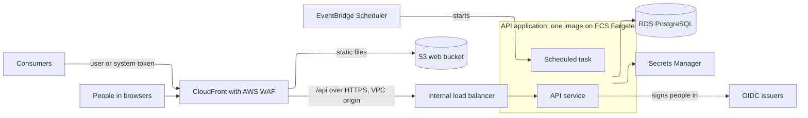

# Architecture

The technology baseline and architectural rules every application built from the template follows. The reasons are in the AI application standard.

## Shape

- The application has a web interface, an API running in a container and a PostgreSQL database, hosted on AWS.
- The API holds all business logic, validation and access control. The web interface is one client of the API among others; other systems use the same versioned API.
- Nothing reads or writes the database except the API application's own code: the API service, its scheduled tasks and the migration step, all from the same image. Only the migration step changes the schema. Anything outside the API application, including other systems and the web interface, goes through the API.

## Technology baseline

| Component | Choice | Standard |
|---|---|---|
| API language and framework | Python with FastAPI | D-02 |
| ORM and migrations | SQLAlchemy 2.x and Alembic | D-02 |
| Python packaging | uv, with `uv.lock` committed | D-02 |
| Web interface | React single-page app built with Vite, in TypeScript | D-03 |
| Web routing | React Router | D-03 |
| API client in the web interface | Generated from the API's OpenAPI document | D-02 |
| Identity | Any OpenID Connect issuer, configured by discovery URL: Entra ID by default for internal users, and Entra External ID by default for external users where the application has them, with app roles | D-04 |
| Web sign-in | The API as backend-for-frontend: it signs people in and holds a server-side session; the browser holds only a session cookie | D-03 |
| Database | PostgreSQL on Amazon RDS | |
| Compute | ECS on AWS Fargate | |
| Web hosting | S3 behind CloudFront | D-03, D-06 |
| Infrastructure as code | Terraform | |
| Pipelines | GitHub Actions, authenticating to AWS through OIDC | D-07 |
| Monitoring | CloudWatch Logs, Container Insights and alarms | D-16 |
| Local development | Docker Compose in WSL with Docker Engine | D-11 |

### Versions

| Component | Version | Pinned in |
|---|---|---|
| Python | 3.13 | `apps/api/pyproject.toml` (`requires-python`) and the `apps/api/Dockerfile` base image |
| Node | 24 (LTS) | `apps/web/.nvmrc` and `engines` in `apps/web/package.json` |
| PostgreSQL | 17 | The Terraform RDS engine version and the `postgres` image in `infra/local/docker-compose.yml` |

These are the template's working versions (Standard configuration default C-02). Each is pinned in the places listed and changed in all of them in the same change. Dependabot proposes patch and minor updates; a major version change is a deliberate change across the listed files.

## API layers

| Layer | Directory | Responsibility |
|---|---|---|
| Routes | `apps/api/routes/` | HTTP handling, role checks, request and response serialisation, transaction ownership |
| Services | `apps/api/services/` | Business logic, rule evaluation, audit recording |
| Domain | `apps/api/domain/` | Domain models, enums, exceptions |
| Repositories | `apps/api/repositories/` | All database access |
| Schemas | `apps/api/schemas/` | Pydantic request and response models, including value-range validation |

Services are stateless and created per request. Routes own the transaction. Services raise domain exceptions and routes translate them to HTTP responses. The detailed rules are in [99-generation-rules.md](99-generation-rules.md#layers).

## API governance

- Versioned by path: `/api/v1`. `/api/health` and the sign-in endpoints under `/api/auth/` are the only unversioned endpoints.
- Paths name the resource, not the caller: `/api/v1/customers/{id}` and `/api/v1/accounts/{id}` serve internal users, external users and systems alike, and who may call each operation is set by the caller's identity and roles (Standard D-18).
- The OpenAPI document generated by FastAPI is the contract. The web interface's client is generated from it.
- Backward compatibility is kept within a major version. A breaking change needs a new major version.
- One error format for every response ([21-api.md](21-api.md#error-response)).
- Correct HTTP status codes: 4xx for client errors and 5xx for server errors.

## API consumers

Every interface is a client of the API (Standard D-18). Other systems, and any separate front end built for external users, call the API from their own servers with their own registrations. Features are therefore always built as API operations first, so an interface can be added or replaced without changing business logic.

Consumers reach the API through the application's CloudFront distribution and AWS WAF (Standard D-19). The API validates every token itself and publishes its OpenAPI document, so a gateway can later be placed in front without changing the application.

## Background processing

| Need | Pattern | Standard |
|---|---|---|
| Scheduled work (data loads, defined exports, threshold checks) | EventBridge Scheduler starts an ECS task from the API image with a different command | D-12 |
| Asynchronous work triggered by an API action | An SQS queue and a worker ECS service from the API image | D-12 |
| Multi-step processing with retries and compensation | Step Functions | D-12 |

Only the scheduled pattern is scaffolded. An application that needs the other two records an ADR and follows the standard's description of them. Background tasks run as the `job` actor type and use the same services, repositories and audit recording as the API.

## Reporting and data supply

Operational screens are built in the application (Standard D-17). A defined supply of data to another organisation or system is built as a defined export or integration that records each run. The application provides no generic data export.

An application that needs reporting in a separate BI tool records an ADR first. The tool then reads a published set of reporting views through a read-only database role, never the application's tables directly, and never audit records or personal information without the data owner's approval.

## Observability

- Structured JSON logs to standard output, collected by CloudWatch Logs.
- The correlation ID is carried from the browser through the API into every log line and audit record.
- Container Insights, alarms and a dashboard per application, as set out in [12-aws-deployment.md](12-aws-deployment.md#monitoring).
- Distributed tracing is not in the baseline. An application that calls several downstream services records an ADR before adding it.

## Environments

Each merge to `main` produces one build: one API image and one web build. That same build is deployed to each environment in turn, unchanged. Only the configuration differs between environments: the API's settings, the values in Secrets Manager and the web interface's `config.json`, which holds only the environment name. Nothing is rebuilt for `test` or `prod`.

| Environment | Purpose | What is deployed, and when |
|---|---|---|
| Local | Development on a developer's machine | The developer's working copy, run with Docker Compose |
| `dev` | Shared development and integration | Each new build, automatically on merge to `main` |
| `test` | Testing and user acceptance | A build already deployed to `dev`, once approved |
| `prod` | Live service | A build already deployed to `test`, once approved |

This works because the application is stateless and reads all environment-specific values from configuration at run time.
